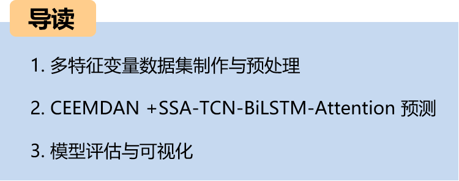
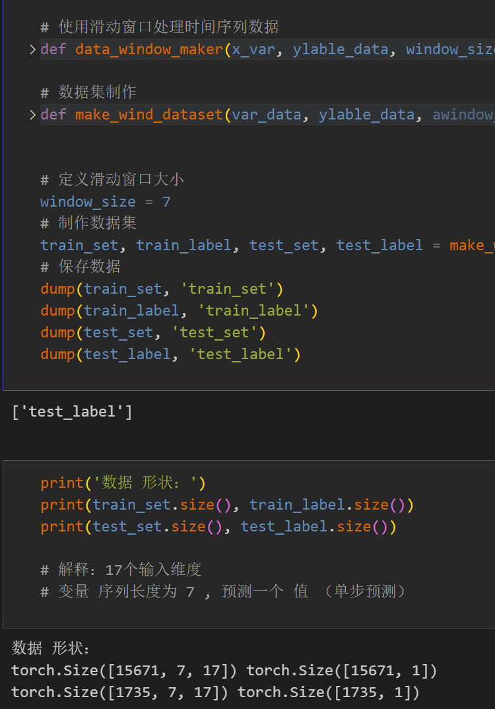
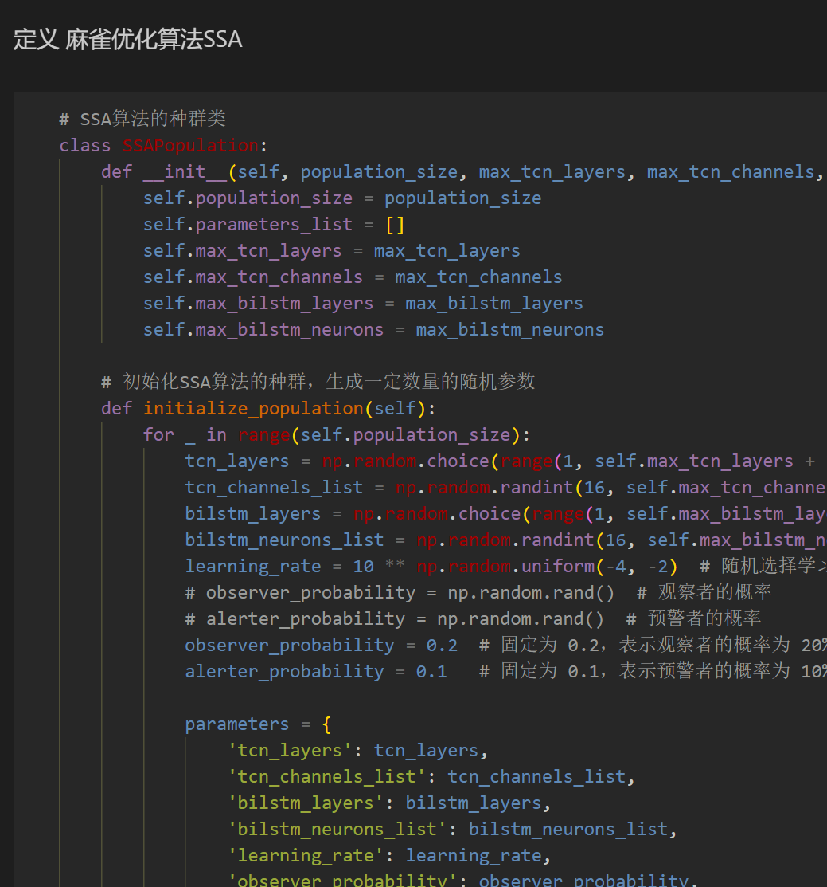
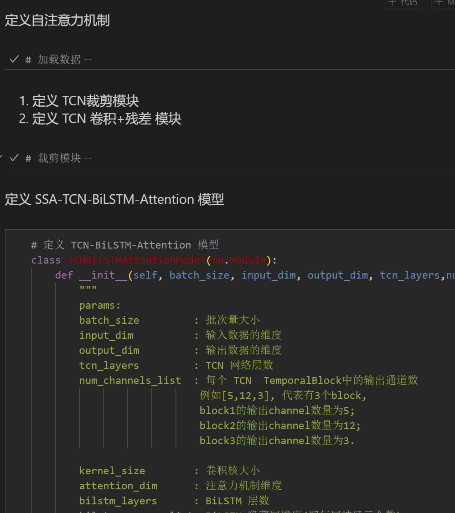
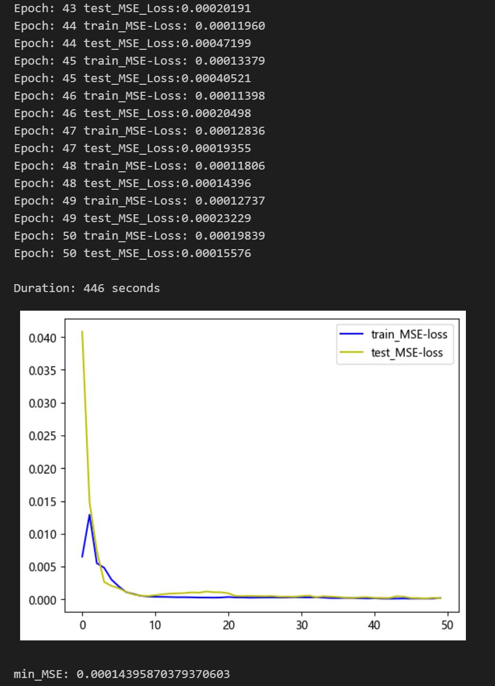
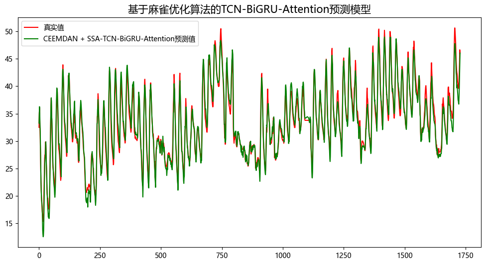
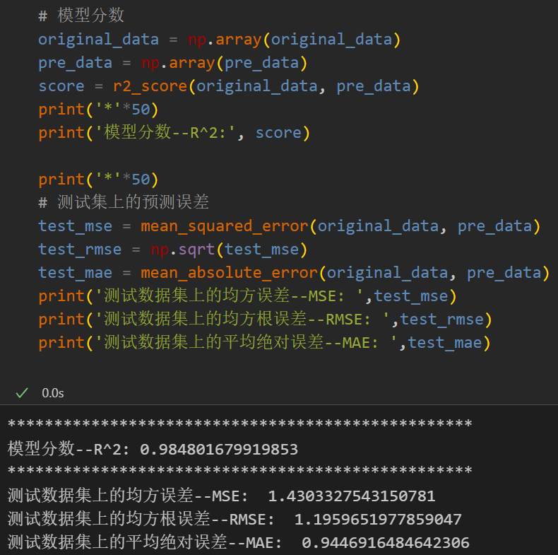
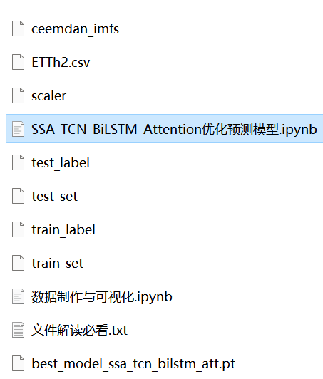

# High Innovation | CEEMDAN + SSA-TCN-BiLSTM-Attention Predictive Model

Including power transformer data, as well as the dataset and label set that has been generated and prepared for production, all corresponding codes can be run.
The CEEMDAN+SSA-TCN-BiLSTM-Attention model has achieved smaller MSE and MAE, showing particularly significant improvements in performance!
Includes data preprocessing code, CEEMDAN decomposition code, complete CEEMDAN+SSA-TCN-BiLSTM-Attention model prediction and visualization code.
Preface
This paper introduces a comprehensive application of the Complete Ensemble Empirical Mode Decomposition (CEEMDAN) and the SSA-TCN-BiLSTM-Attention prediction model based on the optimization algorithm for sparrows, to enhance the predictive performance of time series data. The core of this method is the use of CEEMDAN algorithm to decompose the time series, followed by the optimization of the TCN-BiLSTM-Attention model using the sparrow optimization algorithm. By modeling the decomposed data, precise predictions can be achieved. For a detailed introduction to the power transformer dataset, please refer to the following article:
\tIntroduction to the Power Transformer Dataset and Preprocessing
1 Data CEEMDAN Decomposition and Visualization
1.1 Import data
1.2 CEEMDAN Decomposition
Based on the decomposition results, CEEMDAN has been able to decompose into 11 components. By amalgamating these original data feature variables, a strengthened feature is formed, which serves as the input for the SSA-TCN-BiLSTM-Attention model for prediction purposes.
2. Data Set Creation and Preprocessing
\tDivide the dataset into training set and test set, with a ratio of 8:2.
3. Sparrow Optimization Algorithm
3.1 Introduction to the Sparrow Optimization Algorithm
Sparrow Optimization Algorithm (SSA) is an optimization algorithm based on the characteristics of bird behavior in nature. It simulates the optimization strategies of birds in foraging, migration, and social interactions. The algorithm demonstrates good performance in solving various optimization problems.
The basic idea of Sparrow Optimization Algorithm is to continuously optimize solutions in the search space by simulating the foraging behavior of birds. The process can be divided into three stages: foraging behavior, migration behavior, and social behavior.
1. Foraging Behavior: When searching for food, birds choose food sources that are closer and have higher fitness values. In the algorithm, each individual in the solution space is considered a food source with a fitness evaluation value. Birds select individuals with higher fitness values to find better solutions.
2. Migration Behavior: If birds do not find better solutions after searching around a food source for a certain period, they will choose to leave the current food source and continue searching for other food sources. In the algorithm, the position information between individuals will change to simulate the migration behavior of birds.
3. Social Behavior: When birds are foraging, they communicate with other birds to obtain more information and improve their foraging efficiency. In the algorithm, individuals exchange information to improve their solutions and update the optimal solution in the solution space.
\t3.2 Python-based implementation of Sparrow Optimization Algorithm
\t3.3 Sparrow Optimization Algorithm - Parametric Optimization Process
The Sparrow Optimization Algorithm has the characteristics of simplicity, easy implementation, global optimization capability, and self-adaptability, making it suitable for solving combinatorial optimization problems. We use the Sparrow Optimization Algorithm to perform parameter optimization for the TCN-BiLSTM-Attention model.
By setting the appropriate population size and number of optimization iterations, we search for the optimal parameters within the given hyperparameters range.
4. Prediction Model Based on SSA-TCN-BiLSTM-Attention
4.1 Define the SSA-TCN-BiLSTM-Attention prediction model
4.2 Set parameters and train the model
After 50 epochs, the MSE is 0.000143, indicating that the SSA-TCN-BiLSTM-Attention prediction model performs well. Further adjustment of model parameters can further improve the prediction performance.
Note: Adjust parameters as needed:
Modify the population size and optimization iterations of the bird optimization algorithm;
Adjust the parameter search range for TCN and BiLSTM layers and dimensions, increase more epochs (be cautious to prevent overfitting);
Change the sliding window length (set a suitable window length)
4.3 Model Evaluation
Visualize prediction results
Model evaluation:
Previously excellent content:
Time series prediction: Analysis and comparison of LSTM, ARIMA, Holt-Winters, SARIMA models
Introduction to wind speed prediction dataset and preprocessing
Wind speed prediction (I): Data set introduction and preprocessing
Wind speed prediction (II): EMD-LSTM model based on Pytorch
Wind speed prediction (III): EMD-LSTM-Attention model
Wind speed prediction (IV): EMD-Transformer model based on Pytorch
Wind speed prediction (V): EMD-CNN-LSTM model based on Pytorch
Wind speed prediction (VI): EMD-CNN-GRU parallel model based on Pytorch
CEEMDAN + combined prediction model (BiLSTM-Attention + ARIMA)
CEEMDAN + combined prediction model (CNN-LSTM + ARIMA)
CEEMDAN + Combination Prediction Model (Transformer - BiLSTM + ARIMA)  
CEEMDAN + Combination Prediction Model (CNN-Transformer + ARIMA)  
Multi-Feature Variable Sequence Forecasting (I) - CNN-LSTM Wind Speed Forecasting Model  
Multi-Feature Variable Sequence Forecasting (II) - CNN-LSTM-Attention Wind Speed Forecasting Model  
Multi-Feature Variable Sequence Forecasting (III) - CNN-Transformer Wind Speed Forecasting Model  
Multi-Feature Variable Sequence Forecasting (IV) Transformer-BiLSTM Wind Speed Forecasting Model  
Multi-Feature Variable Sequence Forecasting (V) CEEMDAN+CNN-LSTM Wind Speed Forecasting Model  
Multi-Feature Variable Sequence Forecasting (VI) CEEMDAN+CNN-Transformer Wind Speed Forecasting Model  
Predictive Model Based on the Particle Swarm Optimization Algorithm SSA - CEEMDAN-BiLSTM-Attention  
Predictive Model Based on the Particle Swarm Optimization Algorithm SSA - CEEMDAN-Transformer-BiGRU  
Superior Predictive Model: Secondary Decomposition-Combination Prediction  
Multi-Feature Variable Sequence Forecasting (VII) CEEMDAN+Transformer-BiLSTM Forecasting Model  
Multi-Feature Variable Sequence Forecasting (VIII) Predictive Model Based on the Particle Swarm Optimization Algorithm SSA-CEEMDAN-SSA-BiLSTM Forecasting Model  
Multi-Feature Variable Sequence Forecasting (11) Predictive Model Based on Pytorch's TCN-GRU Forecasting Model  
VMD + CEEMDAN Secondary Decomposition, CNN-LSTM Prediction Model  
VMD + CEEMDAN Secondary Decomposition, CNN-Transformer Prediction Model  
Predictive Model - Code All-in-One Kit based on Particle Swarm Optimization Algorithm SSA  
Introduction to Electric Power Transformer Data Set and Preprocessing

## Images

<!-- PAYMENT_BLOCK -->

## Get this dataset

- Payment link (Stripe): [Buy now](https://buy.stripe.com/3cs8yP7sY87d0vu9AB)
- Payment QR code: 

<!-- /PAYMENT_BLOCK -->
